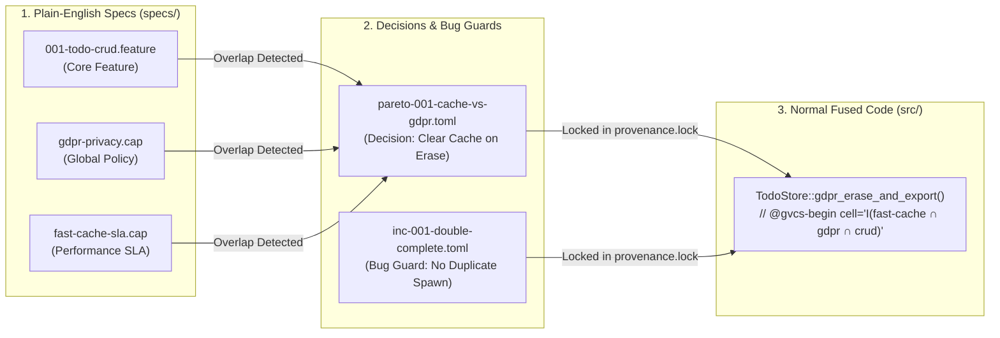

# `gvcs` — Feature-Aware Version Control for AI-Assisted Codebases

> **Git tracks *when* a line of code changed. `gvcs` tracks *which features* own every block of code—and catches when two features collide.**

When you build software with AI coding agents (Claude Code, Cursor, Copilot), you can generate 100,000 lines of code in weeks. **And around Month 6, every AI-generated codebase hits the same wall:**

1. **Intent Amnesia:** Nobody knows if lines 220–280 of `src/lib.rs` exist for *Recurring Tasks*, *GDPR Compliance*, or a *3 AM bugfix* from three months ago.
2. **Regression Roulette:** You ask the AI to add Feature #20, and it silently deletes a caching tradeoff you agreed on for Feature #4.
3. **Fear of Deleting Features:** You want to rip out an old feature (like *Google Login* or a *CLI View*), but you're afraid of breaking shared database queries.

**`gvcs` sits alongside Git as a zero-runtime-overhead control plane.** You write plain-English specs (`specs/`), record product tradeoff decisions once, and keep normal, blazing-fast Rust/TypeScript/SQL code in `src/`—cryptographically linked together by `provenance.lock` (the `package-lock.json` for feature intent).

---

## Side-by-Side: Normal AI + Git vs. `gvcs`

| Everyday Situation | Normal AI + Git | With `gvcs` |
| :--- | :--- | :--- |
| **Adding a global rule** (e.g., *"1-Click GDPR Delete"*) | Hope the AI remembers to update every table, cache, and endpoint across 50 files. | Write one rule (`Rule: For ANY feature that stores personal user data...`). `gvcs` automatically finds every overlapping feature. |
| **Two specs conflict** (e.g., *"<25ms Read Cache"* vs. *"0ms Stale Data after GDPR Delete"*) | The AI silently guesses one way today, and guesses the opposite way on the next refactor. | `gvcs check` flags the overlap, presents concrete options, and locks your choice in a **Product Decision Record** (`.toml`). |
| **Removing a feature** (e.g., removing `recurring-tasks` or `google-login`) | Grep around, delete code by hand, pray you didn't break `#tags` or task completion. | Run `gvcs what-if --remove recurring-tasks` to see the exact `[DELETE]` vs. `[SIMPLIFY]` code blocks—and prove via SHA-256 lock that 83% of your codebase stays 100% untouched. |
| **3 AM Production Hotfix** | Edit code directly; next week an AI prompt overwrites your fix because it wasn't in the spec. | `gvcs check` detects the manual edit, gives you a 72-hour **Hotfix Grace Period**, and locks the fix into a permanent **Bug Guard** (`.incident.toml`). |

---

## How `gvcs` Works in One Diagram

No weird runtime wrappers. No slow LLM calls inside `cargo build`. Just **Specs**, **Product Decisions**, and **Linked Code** held in sync by `provenance.lock`:



---

## 60-Second Interactive Tour

Clone the repo and explore the reference **Todo Web App** ([examples/todo-app](examples/todo-app)) built and governed by `gvcs`:

### 1. See the Feature Map (`gvcs status`)
```bash
cargo run -p gvcs-cli -- status
```
```text
gvcs status — examples/todo-app (lock: 082a91bc ✓ synced)

1. FEATURES & CAPABILITIES (7 active in 4-Layer Priority Stack):
  • cap:fast-cache-sla       Performance & Scale  Capability           [Live (100%)] — Sub-25ms Read Latency SLA via Write-Through Memory Cache
  • cap:gdpr-privacy         Policy & Compliance  Marketplace          [Live (100%)] — EU Privacy Safe (GDPR Right to Erasure & Portability)
  • cap:web-ui               UI & Platform        Capability           [Live (100%)] — Interactive Single-Page Web UI & REST API Server
  • feat:recurring-tasks     Core Feature         Feature              [Canary (25% flag=flag_recurring_tasks)] — Recurring tasks automatically spawn the next occurrence upon completion
  • feat:tags-and-search     Core Feature         Feature              [Live (100%)] — Users can organize tasks with project tags, search keywords, and filter views
  • feat:todo-crud           Core Feature         Feature              [Live (100%)] — Users can create, list, and complete todo tasks
  • native:priority-decay    Core Feature         @native (src/native_priority.rs) [Live (100%)] — Real-time Urgency Scoring Kernel

2. ACTIVE CODE INTERSECTIONS (Where Features Meet in Code) (6 linked code blocks in `src/`):
  • src/lib.rs:25..223           TodoStore::create_todo
      Features:  feat:tags-and-search + feat:todo-crud
      Decisions: EXC-003-crud-vs-tags
  • src/lib.rs:225..286          TodoStore::complete_todo
      Features:  feat:recurring-tasks + feat:tags-and-search + feat:todo-crud
      Decisions: EXC-002-crud-vs-recurring, EXC-004-recurring-vs-tags
      Bug Guard: INC-001-double-complete-spawn
  • src/lib.rs:288..361          TodoStore::list_todos_sorted
      Features:  cap:fast-cache-sla + feat:tags-and-search + feat:todo-crud + native:priority-decay
  • src/lib.rs:363..381          TodoStore::gdpr_erase_and_export
      Features:  cap:fast-cache-sla + cap:gdpr-privacy + feat:todo-crud
      Decisions: PARETO-001-cache-vs-gdpr
  • src/native_priority.rs:6..22 compute_urgency_score
      Features:  native:priority-decay
  • src/web_ui.rs:13..455        web_ui::dispatch_http_request
      Features:  cap:web-ui + feat:tags-and-search + feat:todo-crud + native:priority-decay
```

### 2. Launch the Live Web UI with "gvcs Provenance X-Ray"
```bash
cargo run -p todo-app -- serve --addr 127.0.0.1:8080
```
Open **`http://127.0.0.1:8080`** in your browser. Click the **`🔬 gvcs Provenance X-Ray: ON`** button in the header to inspect which features, product decisions (`EXC-002`, `PARETO-001`), and bug guards (`INC-001`) power every card on the screen—or toggle **`🐤 Canary Recurring Tasks`** on and off live!

*(Want a sub-second terminal walkthrough without opening a browser? Run `cargo run -p todo-app -- demo`).*

### 3. Slice the Codebase by Any Feature (`gvcs slice`)
```bash
cargo run -p gvcs-cli -- slice gdpr-privacy
```
Instantly points to `src/lib.rs:363..381` (`TodoStore::gdpr_erase_and_export`), showing that it combines `cap:fast-cache-sla + cap:gdpr-privacy + feat:todo-crud`, enforces decision `PARETO-001-cache-vs-gdpr`, and is verified by `test_gdpr_erasure_wipes_storage_and_cache_synchronously`.

### 4. Preview Feature Removal Blast Radius (`gvcs what-if`)
```bash
cargo run -p gvcs-cli -- what-if --remove recurring-tasks
```
```text
gvcs what-if --remove `feat:recurring-tasks`:

  1. Code Blocks to Delete or Simplify in `src/` (1 of 6 code blocks affected):
    • [SIMPLIFY] src/lib.rs:225..286 — `TodoStore::complete_todo`
        Currently combines: feat:recurring-tasks + feat:tags-and-search + feat:todo-crud
        After removal:      Retains only `feat:tags-and-search + feat:todo-crud`

  2. Product Decisions & Bug Guards Retired (3):
    • Drops decision EXC-002-crud-vs-recurring
    • Drops decision EXC-004-recurring-vs-tags
    • Retires bug guard INC-001-double-complete-spawn

  3. Untouched Code Guarantee:
    ✓ 5 of 6 code blocks (83% of tracked codebase) remain 100% UNTOUCHED (verified by SHA-256 lock).
```

### 5. Run the CI Gate & Full Test Suite (`gvcs check` & `cargo test`)
```bash
cargo run -p gvcs-cli -- check
cargo test --workspace
```

---

## Inside a `gvcs` Project: Clean, Human-First Files

Product Owners and engineers never have to write compiler jargon. Look at the actual files in [`examples/todo-app/specs/`](examples/todo-app/specs):

### 1. A Feature Spec (`specs/features/002-recurring-tasks.feature`)
Pure Gherkin—zero boilerplate headers required:
```gherkin
Rollout: Canary 25% (flag_recurring_tasks)

Feature: Recurring tasks automatically spawn the next occurrence upon completion
  As a power user with repeating habits
  I want completed recurring tasks to schedule their next instance
  So that I don't have to re-enter weekly routines manually

  Scenario: Completing a recurring task spawns the next cycle
    Given a todo task with recurrence rule "Every 7 days"
    When the user marks the task as completed
    Then the current task is marked Completed
    And a new Pending task is automatically spawned for the next cycle
```

### 2. A Global Policy (`specs/capabilities/gdpr-privacy.cap`)
```gherkin
Uses: @marketplace/eu-gdpr-privacy-safe@3.1.0

Capability: EU Privacy Safe (GDPR Right to Erasure & Portability)
  Rule: For ANY feature that stores personal user data, provide 1-click full erasure and JSON export with zero stale reads.
```

### 3. A 4-Line Product Decision (`specs/exceptions/exc-004-recurring-vs-tags.exception.toml`)
When two features meet (`recurring-tasks` and `tags-and-search`), the Product Owner records how they behave together in 4 lines:
```toml
id = "EXC-004-recurring-vs-tags"
between = ["recurring-tasks", "tags-and-search"]
question = "When a recurring task completes and spawns next week's task, what happens to its #tags?"
decision = "Automatically carry forward all #tags from the completed task to the newly spawned task."
```

### 4. A 5-Line Bug Guard (`specs/incidents/inc-001-double-complete.incident.toml`)
When a 3 AM production bug is fixed, it leaves a permanent mark so future AI edits never re-introduce the bug:
```toml
id = "INC-001-double-complete-spawn"
title = "Double-clicking Complete on a recurring task spawned two duplicate future tasks"
features = ["recurring-tasks", "todo-crud"]
what_happened = "A client sent two concurrent complete requests during a network retry, causing two duplicate recurring tasks to spawn."
never_again = "Completing an already-Completed task must be a safe no-op and NEVER spawn a second recurring task."
test = "test_inc_001_idempotent_complete_never_spawns_duplicate_recurrence"
```

---

## Architecture & Engineering FAQs

<details>
<summary><b>Why not hide generated code in <code>.gitignore</code> and compile specs via an LLM during <code>cargo build</code>?</b></summary>

Putting a probabilistic LLM inside the build loop destroys **build hermeticity** (two CI builds can produce different binaries), makes builds slow and expensive, creates a "test-unfused, ship-fused" hazard, and fails SOC2/PCI/FDA regulatory audits. `gvcs` treats fused source code like `package-lock.json`: code is synthesized and verified once during `gvcs sync`, committed deterministically to `src/` alongside `provenance.lock`, and built with standard `cargo build` in milliseconds.
</details>

<details>
<summary><b>Why not isolate every feature into its own runtime Lambda function or Entity-Component-System (ECS)?</b></summary>

Forcing 100% spatial isolation at runtime causes $O(F \times E)$ database read-join amplification, distributed lock contention, and breaks 120fps UI layout choreography. By isolating features in the **Provenance Graph (`provenance.lock`)** instead of at runtime, overlapping features fuse into normal, single-process functions and SQL queries in `src/` while retaining surgical editability and deletion.
</details>

<details>
<summary><b>How does <code>gvcs</code> prevent $2^N$ combinatorial explosions when rules apply to other rules?</b></summary>

`gvcs` automatically organizes specifications into a **4-Layer Priority Stack**:
1. **Core Feature (`L0`)**: Domain behaviors (`todo-crud`, `recurring-tasks`, `tags-and-search`)
2. **Policy & Compliance (`L1`)**: Global rules (`gdpr-privacy`)
3. **UI & Platform (`L2`)**: User interfaces (`web-ui`)
4. **Performance & Scale (`L3`)**: Operational SLAs (`fast-cache-sla`)

Higher layers can apply rules (`Rule: For ANY...`) across lower layers, guaranteeing that feature overlap discovery terminates in a single pass with zero circular loops.
</details>

<details>
<summary><b>What if I have performance-critical math, shaders, or algorithms where prose is 10x worse than code?</b></summary>

Add `Native: src/native_priority.rs::compute_urgency_score` to a spec ([003-priority-scoring.feature](examples/todo-app/specs/features/003-priority-scoring.feature)). `gvcs` treats it as a sealed, handwritten `@native` module—never overwritten by AI—while still tracking every feature that connects to it.
</details>
