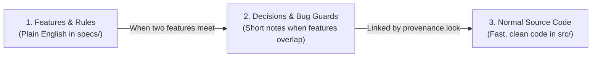

# `gvcs` — Feature-Aware Version Control

> **Git remembers *when* a line of code was written. `gvcs` remembers *which features* that code exists for—and what happens when two features meet.**

---

## The Story: Why AI-Written Projects Get Stuck

Today, you can describe an app to an AI coding assistant and have a working prototype by lunch. For the first few features, it feels like magic.

Then the project grows. By feature #15 or #20, something breaks:

- **Nobody knows why a piece of code is there.** Looking at a 60-line function in `src/lib.rs`, neither you nor the AI knows if a specific `if` check was written for *Recurring Tasks*, *GDPR Privacy*, or a *late-night bugfix* three months ago.
- **New features silently break old agreements.** You ask the AI to speed up the app with a memory cache, and it accidentally breaks a privacy rule that says deleted user data must disappear immediately.
- **Deleting a feature is terrifying.** When you decide to remove an old feature (like *Google Login* or a *CLI view*), its code is tangled up with everything else. You don't know what is safe to delete and what will break the rest of the app.

The root cause is simple: **Git tracks lines of code, not features.** Once the AI writes the code, the link between *what you asked for* and *which lines of code do it* disappears.

---

## The Idea: Keep the Link Alive

What if every block of code in your project knew **which features** it belonged to?

With `gvcs`, your project has three simple parts that stay permanently connected:



1. **You write Features & Rules in plain English** (`specs/`).
   - A **Feature** describes what users can do (*"Users can create and complete todo tasks"*, *"Recurring tasks spawn next week's task when completed"*).
   - A **Global Rule** (Capability) applies across the whole app (*"For ANY feature storing personal data, support 1-click GDPR delete"*, *"Serve list views from a fast memory cache"*).
2. **`gvcs` spots where features overlap—and records your decisions.**
   - What happens when *"Fast Memory Cache"* meets *"1-Click GDPR Delete"*? If data is cached in memory, does deleting an account clear the cache immediately?
   - Instead of letting the AI guess, `gvcs` asks the question once and saves your answer in a 4-line **Product Decision** file.
   - And when you fix a production bug, you save a 4-line **Bug Guard** file so future AI edits never bring that bug back.
3. **Your actual code in `src/` stays fast and normal.**
   - Each function in `src/` has a simple comment tag showing which features meet inside it (for example, `features="todo-crud + recurring-tasks + tags-and-search"`).
   - A lockfile (`provenance.lock`) remembers the exact fingerprint of every code block and its tests.

---

## See It on a Real Example: The Todo App

Inside [`examples/todo-app`](examples/todo-app), we built a complete Todo Web Application using `gvcs`. Here is what the actual files look like:

### 1. A Feature (`specs/features/002-recurring-tasks.feature`)
Written in natural language—no technical boilerplate required:
```gherkin
Rollout: Canary 25% (flag_recurring_tasks)

Feature: Recurring tasks automatically spawn the next occurrence upon completion
  As a power user with repeating habits
  I want completed recurring tasks to schedule their next instance
  So that I don't have to re-enter weekly routines manually

  Scenario: Completing a recurring task spawns the next cycle
    Given a todo task with recurrence rule "Every 7 days"
    When the user marks the task as completed
    Then the current task is marked Completed
    And a new Pending task is automatically spawned for the next cycle
```

### 2. A Global Rule (`specs/capabilities/gdpr-privacy.cap`)
Written once, and automatically connected to every feature that touches personal data:
```gherkin
Uses: @marketplace/eu-gdpr-privacy-safe@3.1.0

Capability: EU Privacy Safe (GDPR Right to Erasure & Portability)
  Rule: For ANY feature that stores personal user data, provide 1-click full erasure and JSON export with zero stale reads.
```

### 3. A Product Decision (`specs/exceptions/exc-004-recurring-vs-tags.exception.toml`)
When *Recurring Tasks* and *Project `#tags`* meet on the same tasks, how should they work together?
```toml
id = "EXC-004-recurring-vs-tags"
between = ["recurring-tasks", "tags-and-search"]
question = "When a recurring task completes and spawns next week's task, what happens to its #tags?"
decision = "Automatically carry forward all #tags from the completed task to the newly spawned task."
```

### 4. A Bug Guard (`specs/incidents/inc-001-double-complete.incident.toml`)
When a double-click bug happened in production, it was turned into a permanent rule and test:
```toml
id = "INC-001-double-complete-spawn"
title = "Double-clicking Complete on a recurring task spawned two duplicate future tasks"
features = ["recurring-tasks", "todo-crud"]
what_happened = "A client sent two concurrent complete requests during a network retry, causing two duplicate recurring tasks to spawn."
never_again = "Completing an already-Completed task must be a safe no-op and NEVER spawn a second recurring task."
test = "test_inc_001_idempotent_complete_never_spawns_duplicate_recurrence"
```

---

## Try It Yourself in 60 Seconds

### 1. Open the Visual Feature Explorer (`gvcs ui`)
```bash
cargo run -p gvcs-cli -- ui --addr 127.0.0.1:4400
```
Open **`http://127.0.0.1:4400`** in your browser. Click any feature in the left sidebar to see the exact Rust code blocks in `src/` that implement it, the product decisions it follows, and what would happen if you removed it.

### 2. Run the Todo Web App (`todo-app serve`)
```bash
cargo run -p todo-app -- serve --addr 127.0.0.1:8080
```
Open **`http://127.0.0.1:8080`** to use the actual Todo Web App (add tasks with `#tags`, set recurring schedules, filter by tag, and test 1-click GDPR export & delete).
*(Or run `cargo run -p todo-app -- demo` for a 1-second terminal walkthrough).*

### 3. Ask `gvcs` Questions from the Terminal

**See all features and where they meet in code:**
```bash
cargo run -p gvcs-cli -- status
```

**Find every line of code and test that exists for GDPR Privacy:**
```bash
cargo run -p gvcs-cli -- slice gdpr-privacy
```

**Preview what happens if you remove Recurring Tasks before touching any code:**
```bash
cargo run -p gvcs-cli -- what-if --remove recurring-tasks
```
`gvcs` tells you that removing `recurring-tasks` only simplifies 1 function (`TodoStore::complete_todo` in `src/lib.rs`), retires 2 decisions and 1 bug guard, and leaves **83% of your codebase (5 of 6 code blocks) 100% untouched**.

**Verify that all specs, decisions, tests, and code are in sync:**
```bash
cargo run -p gvcs-cli -- check
cargo test --workspace
```

---

## Common Questions (For Both Founders & Engineers)

<details>
<summary><b>Why keep normal source code in Git instead of having AI generate code from scratch on every build?</b></summary>

If an AI regenerates your code during every build, builds become slow, expensive, and unpredictable—two builds of the exact same specs could produce slightly different apps. Worse, security and compliance auditors require the exact code running in production to be saved in version control.

`gvcs` gives you the best of both worlds: AI writes and updates the code when you change a spec (`gvcs sync`), and the resulting clean, fast code is committed to `src/` alongside `provenance.lock`. Regular builds (`cargo build`) run in milliseconds with zero AI overhead.
</details>

<details>
<summary><b>Why combine overlapping features into shared functions instead of keeping every feature in its own separate file or microservice?</b></summary>

In real apps, features naturally share data and screens. For example, loading the Todo list needs to fetch tasks (*Todo CRUD*), filter by tag (*Tags & Search*), sort by urgency (*Priority Scoring*), and save the result in memory (*Fast Cache SLA*).

If those four features ran as four separate wrappers or database calls, the app would be slow and buggy. `gvcs` lets them share a single, fast function in `src/`—while remembering that all four features meet inside that function so you can still edit or remove any one of them cleanly.
</details>

<details>
<summary><b>What if an engineer needs to write custom math or low-level code by hand?</b></summary>

Sometimes 15 lines of math is much clearer than 100 lines of English explanation. In `gvcs`, an engineer can mark any module as handwritten code (`Native: src/native_priority.rs::compute_urgency_score` in [`003-priority-scoring.feature`](examples/todo-app/specs/features/003-priority-scoring.feature)). `gvcs` protects that file from being overwritten by AI while still tracking which features use it.
</details>

<details>
<summary><b>What happens if a developer edits code in <code>src/</code> directly at 3 AM to fix an urgent bug?</b></summary>

When you run `gvcs check`, it compares the fingerprint of every code block in `src/` against `provenance.lock`. If someone edited `src/lib.rs` directly without updating the specs, `gvcs check` immediately spots which function changed and which features it affects—prompting the team to either sync the change or record a `.incident.toml` Bug Guard so the fix is never lost.
</details>
